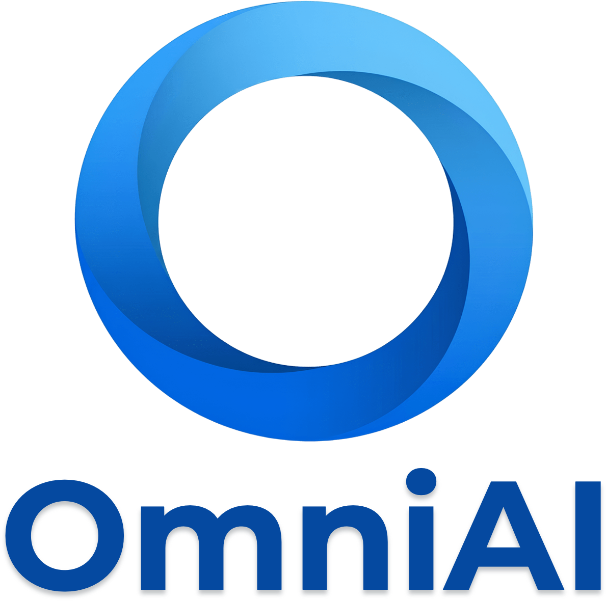
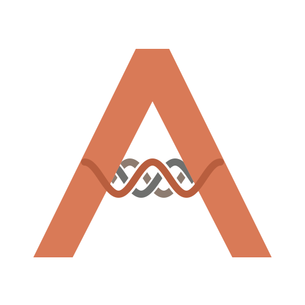
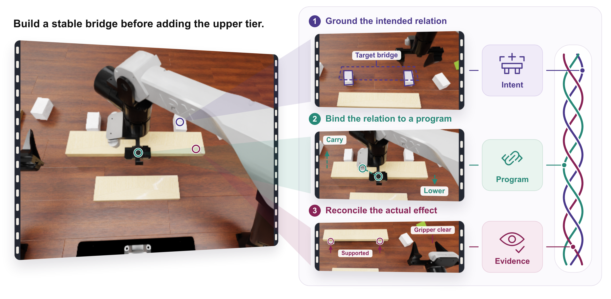
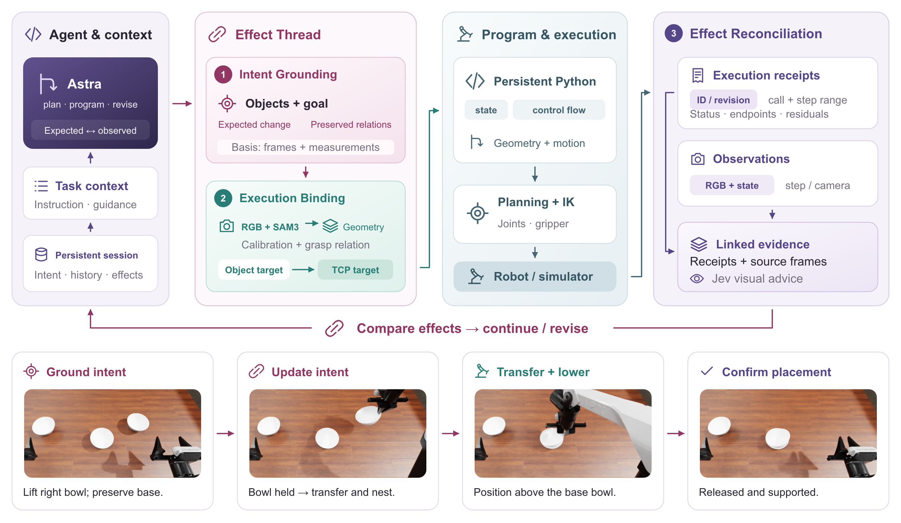
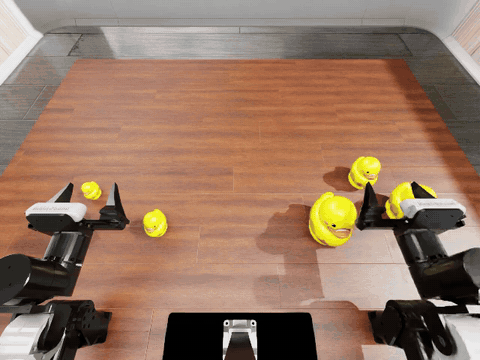
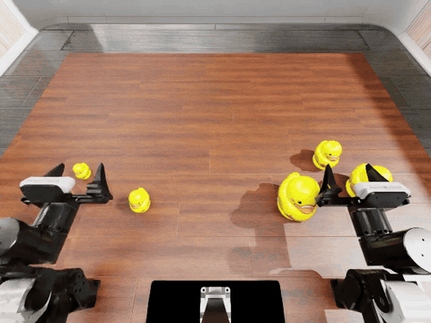

<h1 align="center">
  &nbsp;
  &nbsp;
  ActWeave
</h1>

<p align="center"><strong>Effect-Threaded Programming for Embodied Control</strong></p>

<p align="center">
  <a href="#overview">Overview</a> &middot;
  <a href="#method">Method</a> &middot;
  <a href="#demonstration">Demo</a> &middot;
  <a href="#getting-started">Getting Started</a>
</p>



## Overview

Robot manipulation aims to change relationships in the physical world: an object is securely grasped, a board gains support, or a bowl remains nested after release. These changes often span multiple programs, motions, and observations, while interfaces centered on individual tool calls scatter operation goals, geometric evidence, and effect feedback. This creates an **Intent-Effect Gap: program execution and its intended physical effects lack an explicit, sustained connection.**

**ActWeave makes physical operations a first-class abstraction for embodied programming.** We introduce **Effect-Threaded Programming**, weaving operation intent, executable programs, and effect evidence into an evolving **Effect Thread**. Each operation gains a unified representation across planning, execution, and revision: the goal specifies what should change, the program determines how to change it, and the observed effect informs the next decision.

## Method

ActWeave connects three stages to turn physical goals into executable operations that can be revised through effect feedback.

1. **Intent Grounding: give physical operations explicit, persistent intent.** Organize the objects, current evidence and assumptions, desired change, expected effect, and relations to preserve into an explicit operation intent. The operation retains a clear goal and basis for decisions across successive programs.
2. **Execution Binding: connect object goals to executable programs.** Establish object and functional-point geometry from current measurements, translate object goals into robot motion targets through hand-object bindings, and compose geometric computation, motion, and numerical branches. Link actual execution intervals, endpoints, and errors to the corresponding operation, bringing execution feedback back to the physical goal it serves.
3. **Effect Reconciliation: use observed effects to drive operation revision.** Compare geometric residuals, source images, and visual judgments with the operation's expectations within the same Effect Thread. This comparison informs whether to continue execution, refine parameters, or change the method. The operation's basis and expectations evolve with new evidence, grounding subsequent programs in the physical changes that have occurred.



In ActWeave Agent, **Effect Threads give Astra an operation-level control structure that spans successive decisions**. Astra uses this structure to plan, generate programs, and choose observation and recovery strategies. Persistent Python executes geometric computation, motion, and numerical branches, while Jev supplies visual advice. Linked execution receipts and observation evidence return to Astra to inform the next operation revision. The bowl-stacking sequence illustrates this thread extending from acquisition through transport to supported placement.

## Demonstration

| Baseline | ActWeave |
|:---:|:---:|
|  |  |


## Getting Started

### 1. Install the runtime

Requires Linux, Python **3.11.8+ in the 3.11 series**, Node.js **22.19+**, npm, Git, bubblewrap, ffmpeg, and curl. RoboDojo runs in its own simulation environment. SAM3 requires a separate CUDA-enabled Python environment and GPU; Astra and Jev require API access.

Activate your policy Python environment, then run:

```bash
git clone https://github.com/ZJU-OmniAI/ActWeave.git
cd ActWeave
export ACTWEAVE_ROOT="$PWD"
bash scripts/install.sh
python scripts/download_demonstrations.py
```

The installer adds Python dependencies to the active environment and runs `npm ci`. The downloader retrieves the fixed official training-video references into `assets/demonstrations/`, following [the reference manifest](configs/demonstrations/official-training.json). Open tasks use live observations and instructions, with same-task demonstrations omitted.

Install [SAM3 and its weights](https://github.com/facebookresearch/sam3) with a matching CUDA PyTorch installation in the perception environment. In that environment, run:

```bash
bash "$ACTWEAVE_ROOT/scripts/install_perception.sh"
```

### 2. Configure services and Python isolation

From the repository root:

```bash
cp configs/runtime_template.json configs/runtime.local.json
cp configs/sandbox_template.json configs/sandbox.local.json
export EVO_CONFIG="$ACTWEAVE_ROOT/configs/runtime.local.json"
export OPENAI_BASE_URL="https://your-astra-endpoint/v1"
export OPENAI_API_KEY="your-astra-key"
export JEV_API_KEY="your-jev-key"
```

Edit the local configuration files for your installation:

- **Models:** set `model` to your Astra model ID, and `jev.model` and `jev.endpoint` to your Jev model and full System One URL.
- **Policy Python:** set `policyPython` to the absolute interpreter path in your policy environment.
- **Sandbox:** set `base` and `python` in `sandbox.local.json` to the base Python 3.11 installation and its interpreter. Set the four `mounts` entries to the installed NumPy/Pillow package and shared-library directories.
- **Services and output:** set `ports.bridge`, `ports.perception`, and `outputRoot`. Relative runtime paths resolve against the repository root. Keep `maxRequests: null` for unlimited cumulative model requests.

API credentials are read from the environment. Machine-specific `*.local.json` files and downloaded runtime assets are Git-ignored.

### 3. Start perception and the bridge

Set `ACTWEAVE_ROOT` and `EVO_CONFIG` as above in each terminal. In the SAM3 environment, start perception on an available GPU:

```bash
python "$ACTWEAVE_ROOT/python/perception/server.py" \
  --model /absolute/path/to/sam3.pt --gpu 0 --port 8002 \
  --backend sam3 --runtime-config "$EVO_CONFIG"
```

The service port must match `ports.perception`. For a standalone simulator client, start the bridge in the policy environment with the API variables above:

```bash
npm --prefix "$ACTWEAVE_ROOT" start
```

The bridge listens on `127.0.0.1:8100` by default and waits for simulator observations. It serves one environment per instance.

For RoboDojo evaluation, use the separate ActWeave adapter in [XPolicyLab](https://github.com/XPolicyLab/XPolicyLab) and follow its installation and evaluation instructions for `arx_x5 / joint` with `eval_batch: false`. The adapter manages bridge startup. See the [RoboDojo submission guide](https://robodojo-benchmark.com/doc/usage/robodojo-submission/) for the integration workflow.

## License and Acknowledgements

ActWeave code is released under the [MIT License](LICENSE). Third-party components retain their own licenses, including the [Python PTC primitives](packages/ptc-runtime-python/vendor/NOTICE), [official training-video references](configs/demonstrations/NOTICE), and [RoboDojo calibration](configs/robot_calibration.LICENSE).

We build on [DeepSeek Harness](https://github.com/deepseek-ai/deepseek-harness) for the online Agent runtime and [SAM3](https://github.com/facebookresearch/sam3) for segmentation. We thank [RoboDojo](https://robodojo-benchmark.com/) for the environment and reference data.
